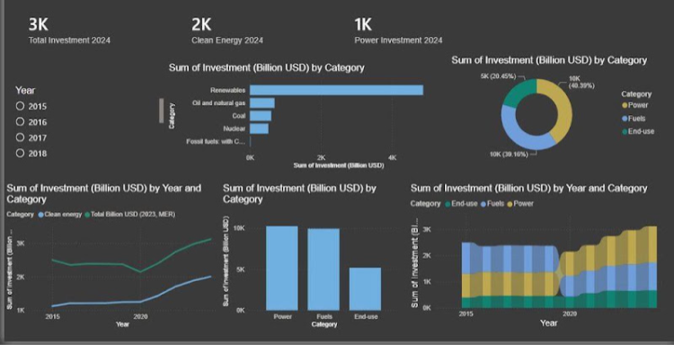
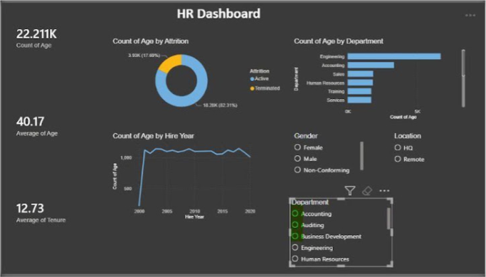
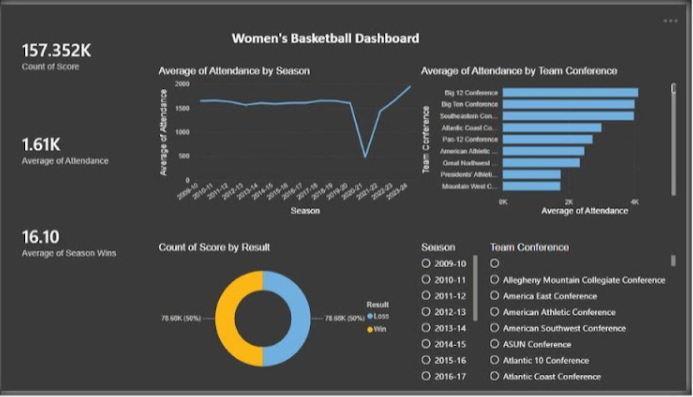
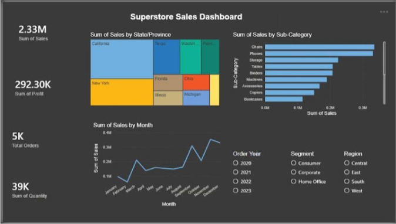

# Power BI Dashboards

Four dashboards I built in Power BI for my MSc Data Visualisation module. These are screenshots only, and the files and data aren't in this repo.

## World Energy Investment

IEA data from 2015 to 2024. The raw table mixed totals, subtotals and components in one wide format, so I reshaped it to long format and added a Level column so my DAX measures wouldn't double count.

Total investment rose by about 25% over the decade, and clean energy's share went from under half to 67%. The data is global only, and the 2024 figures are IEA estimates.

## HR Workforce

22,211 employee records, showing attrition, age, tenure and department. About 18% of records are terminated staff.

## Women's Basketball

157,352 records, showing attendance by season and conference. The sharp dip around 2020-21 stands out.

## Superstore Sales

Sales, profit and orders by state, sub-category and month, for 2.33M in sales and 292K in profit.

